# Fault Diversity Lab

Generate many independent versions of the same program with large language models, test every version, and measure
whether the versions fail in different places, which is what N-version programming with majority voting relies on.

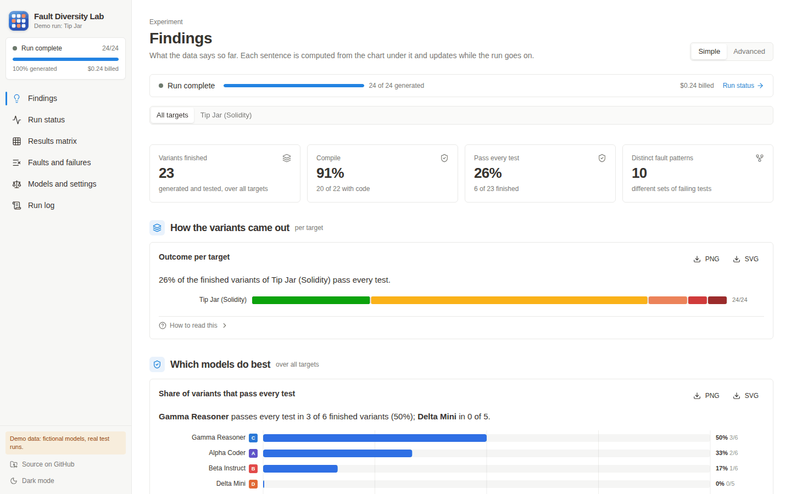

## Why

N-version programming runs several independently developed versions of a component and takes the majority answer.
A 2-of-3 vote is only wrong when at least two versions are wrong on the same input, so the method works as long
as the versions do not fail together. Human-written versions are known to fail together more often than
independence would predict ([Knight and Leveson, 1986](https://doi.org/10.1109/TSE.1986.6312924)).

Language models make it cheap to produce many versions of a program. Whether those versions are diverse is an
open question: models trained on similar data may make the same mistakes (an "LLM monoculture"). This repository
is the tooling to measure that. It sends the same specification to several models under several request
settings, tests every answer against a fixed test suite, and reports how often single versions fail and how often
2-of-3 votes over one model or over different models still fail.

## How it works

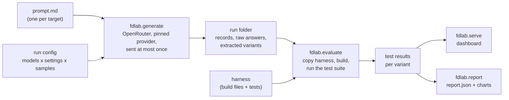

1. A **target** is one program to write: a prompt file and a harness with the test suite.
2. `fdlab.generate` plans every (target, model, setting, sample) request, checks the budget, and sends each
   request once to OpenRouter, pinned to one provider. It stores the raw answer and extracts the code.
3. `fdlab.evaluate` copies the harness for every variant, puts the code in place, builds it and runs the tests
   (Foundry for Solidity, Gradle with JUnit 5 for Java).
4. `fdlab.serve` shows the run in a web dashboard, live while it runs. `fdlab.report` writes the numbers and
   charts for a paper.

## Features

- **Exactly-once generation** with a hard spending cap, crash-safe records and the raw answer bytes of every
  attempt (see [Safety of the generator](#safety-of-the-generator)).
- **Plan mode by default**: shows every request, its pinned provider and its worst-case cost without opening a
  network connection.
- **Strict extraction**: one fenced code block or nothing. Code is never repaired.
- **Isolated tests**: the harness is copied for every variant; runs never share state.
- **Fault-diversity metrics**: single-version failure rate, 2-of-3 vote failure over one model and over three
  different models, coincident failures between model pairs, fault patterns, Wilson intervals
  ([docs/metrics.md](docs/metrics.md)).
- **Dashboard**: findings, run status, results matrix, per-variant pages (prompt, answer, reasoning, code, build
  log, tests, raw record), faults and failures, model and setting comparison, event log, CSV export. Every chart
  downloads as PNG or SVG. Light and dark mode, works on a phone.
- **Offline demo**: a complete run of four fictional models, with real test runs, to try everything without an
  API key.

## Screenshots

All screenshots show the offline demo. Its models and their answers are fictional (hand-made faults in a
reference implementation); the test results are real.

| | |
|---|---|
| 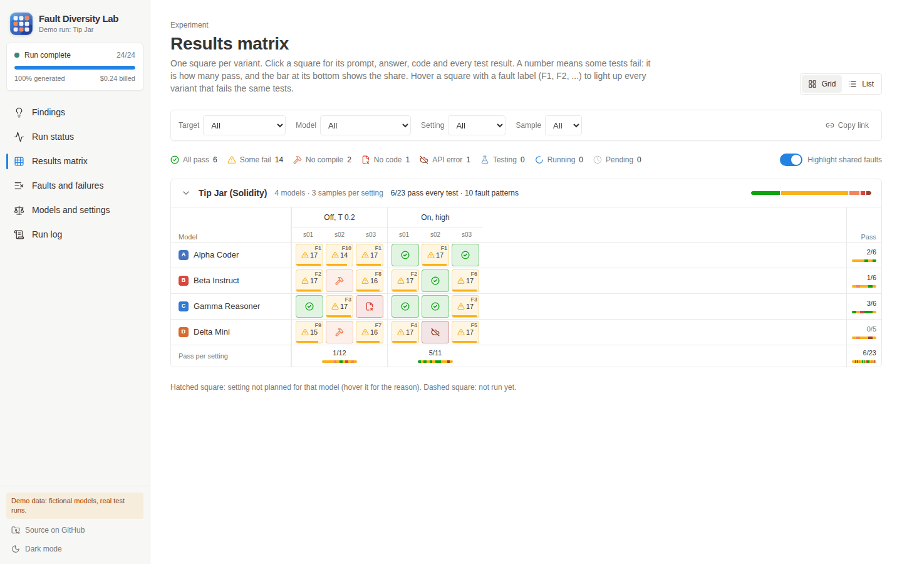 | 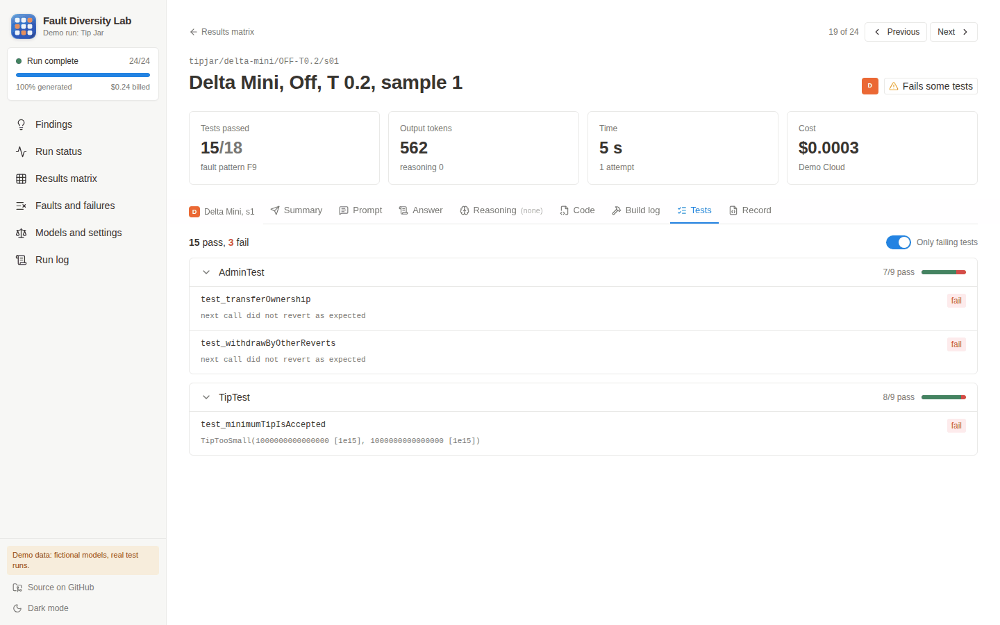 |
| **Results matrix.** One square per variant. Squares with the same label (F1, F2, ...) fail exactly the same tests; hovering one highlights the others. | **Variant page.** Request, answer, reasoning, code, build log, tests and the raw record of one variant. |
| 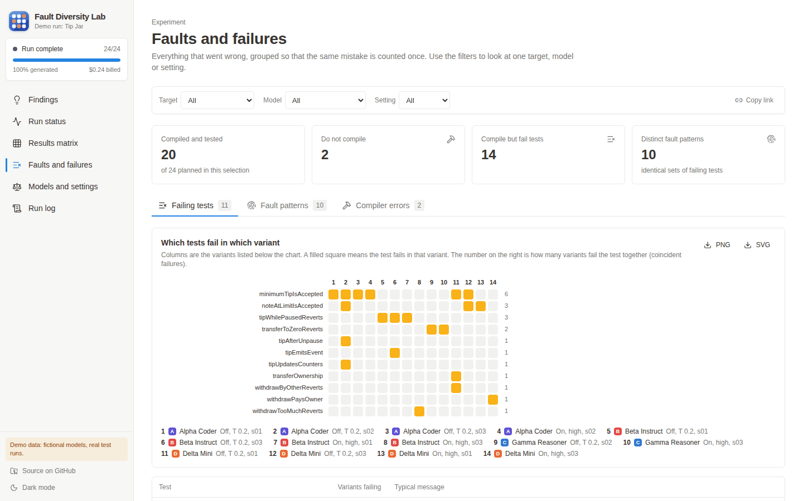 | 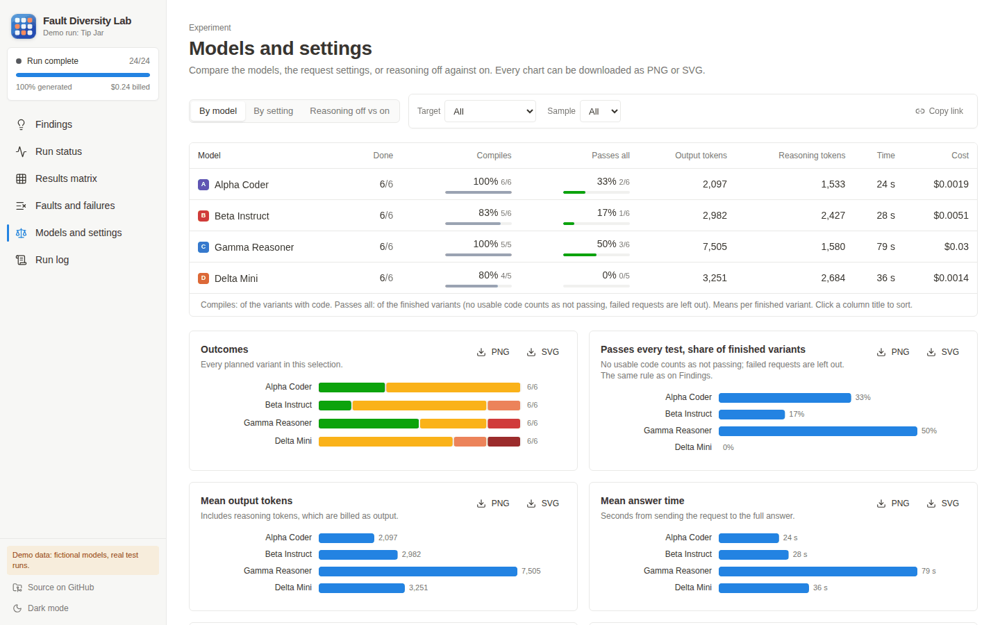 |
| **Faults and failures.** Which test fails in which variant, fault patterns and compiler errors. | **Models and settings.** Compile and pass rates, tokens, time and cost side by side. |
| 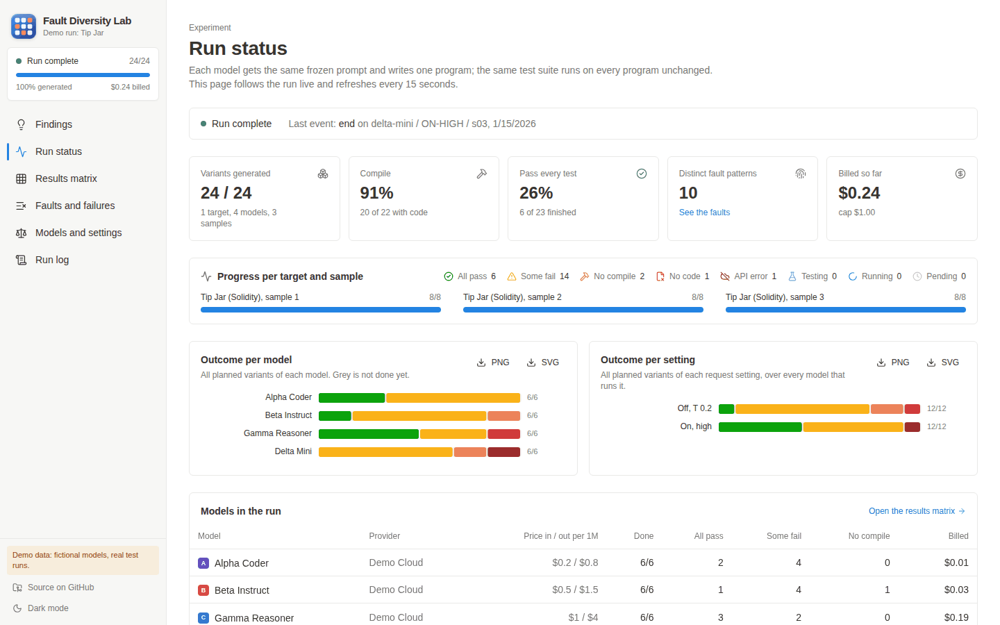 | 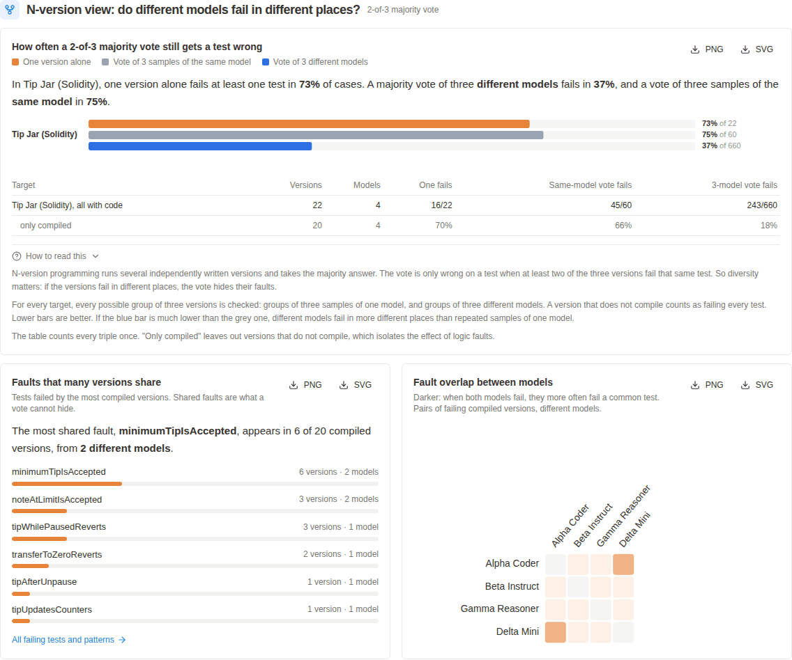 |
| **Run status.** Progress, spending and outcomes, refreshed every 15 seconds. | **N-version view.** How often a 2-of-3 vote still fails, shared faults and fault overlap. |

<p align="center">
  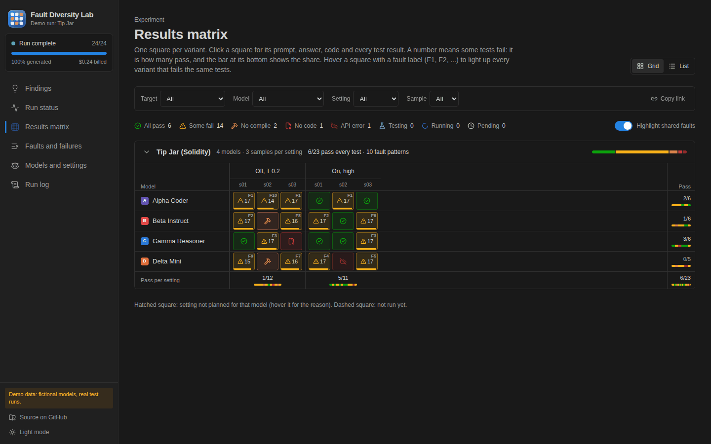
  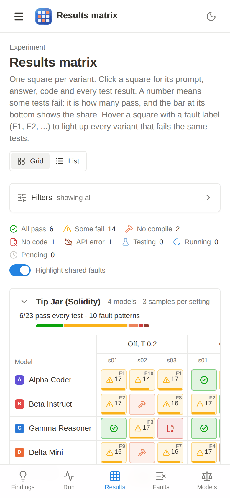
</p>

## Example charts

`fdlab.report` writes four charts. These are from the demo run (fictional models):

| | |
|---|---|
| 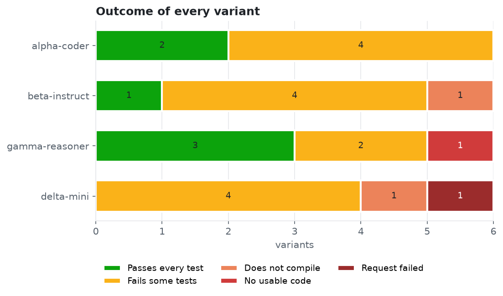 | 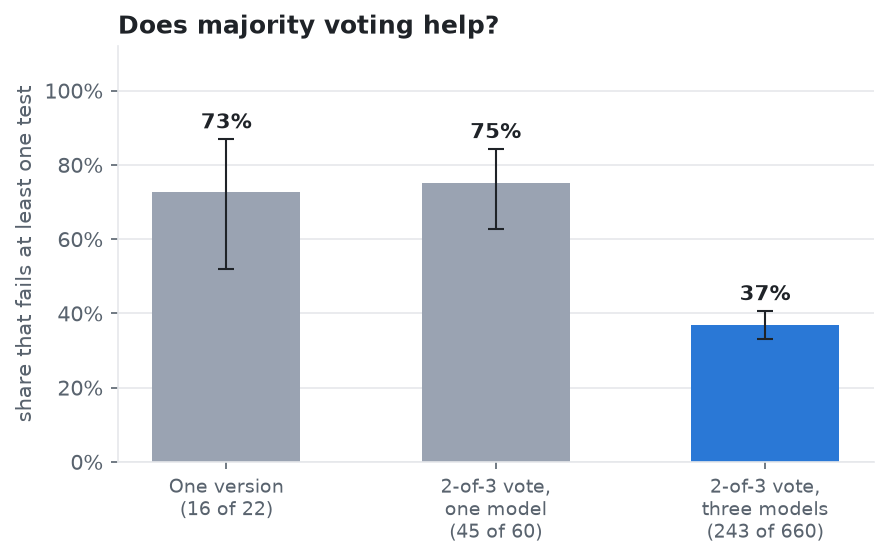 |
| How every variant of each model came out. | Share of single versions, same-model votes and three-model votes that fail at least one test, with 95% Wilson intervals. |
| 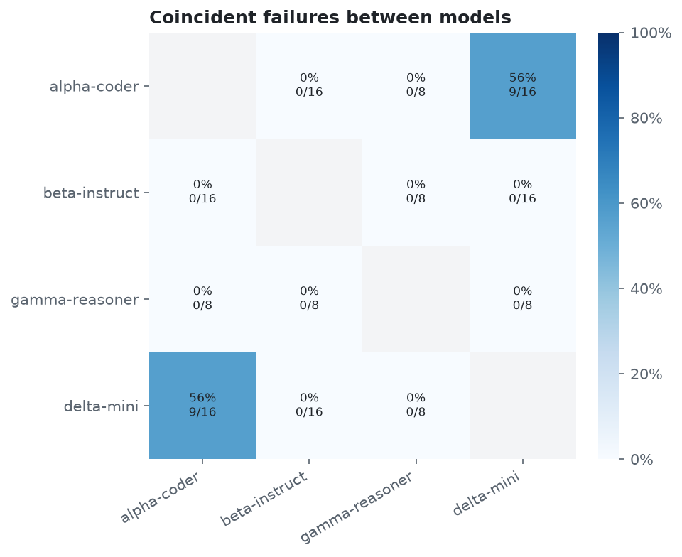 | 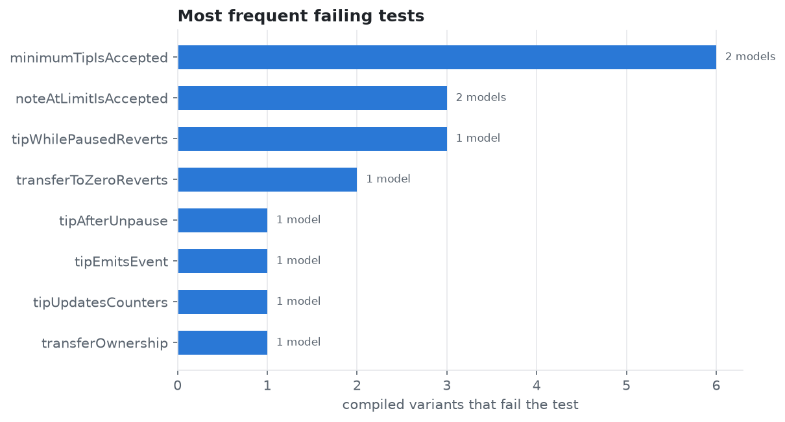 |
| For each pair of models: of their pairs of failing versions, the share that fail a common test. | The tests that fail most often, and in how many models. |

## Quick start

Requirements: Python 3.11 or newer with [uv](https://docs.astral.sh/uv/), Node.js 20 or newer,
[Foundry](https://getfoundry.sh) (`forge`) and git. The demo needs no API key and costs nothing.

```bash
git clone --recursive https://github.com/MYRhouma/fault-diversity-lab.git
cd fault-diversity-lab
uv sync                                    # Python dependencies into .venv
uv run python -m fdlab.demo                # builds runs/demo and tests its 24 variants with forge
(cd web && npm ci && npm run build)        # builds the dashboard into web/dist
uv run python -m fdlab.serve config/demo.json
```

Then open <http://127.0.0.1:8765>. If you cloned without `--recursive`, run `git submodule update --init` first
(the Foundry harness needs `forge-std`). The first test run downloads the Solidity compiler version pinned in the
harness, once.

## Running a real study

1. **Write a config.** Start from [`config/example.json`](config/example.json): targets, settings, models,
   samples, `max_tokens`, `cap_usd`, `out_dir`. For every model, check the provider name, prices and output limit
   on its OpenRouter page; the budget check depends on them. All fields:
   [docs/configuration.md](docs/configuration.md).

2. **Plan.** This never sends anything:

   ```bash
   uv run python -m fdlab.generate config/example.json
   ```

   It lists every request id, its pinned provider, its token limit, its worst-case cost and its state, and stops
   with an error for anything inconsistent (unknown setting fields, an effort level the model does not offer, a
   missing price, a changed prompt).

3. **Send**, with an OpenRouter key that has a credit limit and an explicit cap in US$:

   ```bash
   export OPENROUTER_API_KEY=...             # or copy .env.example to .env and load it
   uv run python -m fdlab.generate config/example.json --send --cap 2
   ```

   Requests go out sample by sample (every `s01` first), so a run stopped by the cap leaves a balanced design.
   Run the same command again to continue; finished requests are skipped.

4. **Test** every variant that has no result yet:

   ```bash
   uv run python -m fdlab.evaluate config/example.json --jobs 4
   ```

5. **Look and report:**

   ```bash
   uv run python -m fdlab.serve config/example.json      # dashboard, also useful while steps 3 and 4 run
   uv run python -m fdlab.report config/example.json     # writes <out_dir>/report/
   ```

## Safety of the generator

Model calls cost money, and a study is only reproducible if every answer is accounted for. The generator
([`fdlab/generate.py`](fdlab/generate.py)) is built around these rules:

- **Exactly once.** Before a request is sent, its record is written with status `in_flight`. A crash leaves that
  status behind, and the id is blocked until you decide. Finished requests are never sent again.
- **No automatic paid re-send.** Retries happen only when nothing can have been billed: the connection never
  opened, or HTTP 429. A timeout after sending, a server error or an error inside an answer becomes
  `needs_review`. Sending such a request again is a manual `--retry <id>`, after checking the OpenRouter activity
  page.
- **A cap that holds.** A local ledger adds the reported cost of every attempt, with the worst case for unknown
  costs and for requests in flight. A request is only sent if the ledger plus its worst case fits under `--cap`.
  `--send` also requires a key with a credit limit, and lowers the cap to the key's remaining credit if that is
  smaller.
- **Provider pinning.** Every request names one provider with fallbacks off. An answer from another provider is
  recorded as `provider_mismatch` and not used.
- **Raw bytes first.** Every HTTP answer is saved byte for byte before it is parsed. Records, raw files and
  variants are written atomically and are never overwritten.
- **Traceable.** Each `--send` writes a manifest with the config, the prompt hashes, the git commit and the tool
  versions. A record whose prompt or request body no longer matches the plan stops the run.
- **Demo configs are never sent.** A config with `"demo": true` is refused by `--send`.

## Configuration

A run config has five parts; see [docs/configuration.md](docs/configuration.md) for every field.

| Part | What it holds |
|---|---|
| `targets` | id, display name, prompt file, test runner (`forge` or `gradle`), harness folder, slot for the generated file |
| `settings` | named request settings, such as `{"reasoning": {"enabled": false}, "temperature": 0.2}` |
| `models` | OpenRouter id, pinned provider, prices, output limit, per-model overrides and skipped settings |
| `samples`, `max_tokens` | repetitions per cell, and the output token limit |
| `cap_usd`, `out_dir` | the largest cap `--send` accepts, and the run folder |

## Adding a target

A target is a prompt file plus a harness: the build files and test suite that every generated file is tested
with. The prompt has a system part, a user part and the name of the file to produce:

```
=== SYSTEM ===
You are an experienced Solidity developer. Answer with one fenced code block.

=== USER ===
Implement the contract described below. ...

Output file: TipJar.sol
```

[`specs/tip-jar/`](specs/tip-jar/) is a small, complete example (prompt, reference implementation, Foundry
harness with 18 tests). [docs/adding-a-target.md](docs/adding-a-target.md) explains the prompt format, the
harness layout, the `slot`, and how to set up Foundry and Gradle harnesses.

## Outcomes

Every planned request ends up with exactly one outcome:

| Outcome | Meaning |
|---|---|
| Not started (`pending`) | No record yet. |
| Generating now (`running`) | The request is in flight. |
| Request failed (`api_error`) | No usable answer: HTTP error, wrong provider, or it needs review. |
| No usable code (`no_code`) | An answer without exactly one code block, empty, or cut off at the token limit. |
| Waiting for tests (`testing`) | Code saved, tests not run yet. |
| Does not compile (`compile_error`) | The build fails, so no test can run. |
| Fails some tests (`partial`) | Compiles, and at least one test fails. |
| Passes every test (`all_pass`) | Compiles, and every test passes. |

The record statuses behind these outcomes and the files of a run are described in
[docs/run-folder.md](docs/run-folder.md).

## Metrics

A **version** is a variant with code (it may not compile; then it fails every test). For each target:

- **single**: share of versions that fail at least one test;
- **same-model vote**: share of triples of versions from one model where a 2-of-3 vote fails at least one test,
  that is, where two of the three fail a common test;
- **three-model vote**: the same for triples from three different models;
- **coincident failures**: for two models, the share of their pairs of failing versions that fail a common test.

If the three-model vote fails much less often than a single version, the models fail in different places and
voting helps. Rates come with 95% Wilson intervals. Definitions and caveats: [docs/metrics.md](docs/metrics.md).

## Project layout

```
fault-diversity-lab/
  fdlab/                Python package
    generate.py         plan and send requests (OpenRouter)
    extract.py          get the code out of an answer
    evaluate.py         build and test variants (forge, gradle)
    dashboard.py        read-only API over a run folder
    serve.py            API + web dashboard
    diversity.py        fault-diversity metrics
    report.py           report.json and charts
    demo.py             the offline demo run
  config/               example.json (a real run) and demo.json (the demo)
  specs/tip-jar/        example target: prompt, reference, Foundry harness
  web/                  dashboard (React, TypeScript, Vite, Tailwind)
  tests/                pytest suite (no network, no paid calls)
  docs/                 configuration, targets, run folder, metrics, images
  runs/                 run folders (not in git)
```

## Development

```bash
uv sync                                   # includes pytest and ruff
uv run pytest                             # Python tests; they use a fake API server on 127.0.0.1
uv run ruff check .
cd web && npx tsc -b && npx oxlint && npm run build
```

For dashboard work, run the API with `uv run python -m fdlab.serve config/demo.json` and the Vite dev server
with `cd web && npm run dev` (it proxies `/api` to port 8765).

## Specifications and data used in the paper

The specifications, prompts, test suites, generated variants and results of the study this tool was built for are
**not** in this repository. They are kept private on purpose, so that they do not end up in the training data of
future models, which would make them useless as a benchmark. They are available for research on request:
yassine.rhouma@edu.bme.hu.

## Citation

This tool was developed for a TDK (Scientific Students' Associations) paper at the Budapest University of
Technology and Economics (BME), 2026. If you use it, please cite:

```bibtex
@misc{rhouma2026faultdiversitylab,
  author       = {Yassine Rhouma},
  title        = {Fault Diversity Lab},
  year         = {2026},
  howpublished = {\url{https://github.com/MYRhouma/fault-diversity-lab}},
  note         = {Software}
}
```

## License

MIT, see [LICENSE](LICENSE).
